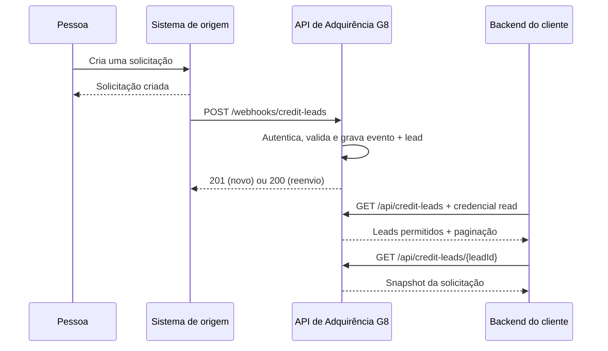

# Integração G8 — Leads de crédito

Guia para o cliente que consulta novas solicitações de carta de crédito.

## Como o lead chega até você



O envio do sistema de origem é assíncrono. Uma solicitação pode ter sido criada e ainda estar aguardando entrega. Assim que o receptor confirma a gravação, o lead fica disponível para consulta.

Nesta integração, a G8 recebe o webhook e o cliente consulta a API. Não existe envio automático de notificações desta API para o webhook do cliente. A credencial de leitura não permite inserir eventos. O registro consultado é um snapshot da criação: este contrato não atualiza andamento/aprovação da solicitação.

## Conexão e credenciais de leitura

Base de produção, após publicação da integração:

```text
https://api-adquirencia.bancog8.com.br
```

Base de desenvolvimento local: `http://localhost:8000`.

A equipe G8 fornece ao cliente, por canal seguro:

- `client_id`: identificador exclusivo da credencial.
- API key: segredo aleatório.
- Origens autorizadas: `PUBLICA`, `AGENTE` e/ou `IB`, conforme o acesso contratado.

Envie os dois headers em todas as consultas:

```http
X-Client-Id: <client_id fornecido pela G8>
X-API-Key: <segredo fornecido pela G8>
```

A credencial precisa do escopo `read`. O backend do cliente deve guardar o segredo em ambiente protegido; não o coloque no frontend, em URLs ou em logs. Não há login, token Bearer ou endpoint público de emissão. A consulta filtra registros e contagem pelas origens autorizadas, sem controle individual por agente.

Para os exemplos seguintes, defina as variáveis no terminal:

```bash
export G8_API_BASE_URL='https://api-adquirencia.bancog8.com.br'
export READER_CLIENT_ID='<client_id fornecido pela G8>'
export READER_KEY='<segredo fornecido pela G8>'
```

## Listar leads

```bash
curl --get "$G8_API_BASE_URL/api/credit-leads" \
  -H "X-Client-Id: $READER_CLIENT_ID" \
  -H "X-API-Key: $READER_KEY" \
  --data-urlencode 'origem=PUBLICA' \
  --data-urlencode 'page=1' \
  --data-urlencode 'page_size=50'
```

Resposta HTTP 200:

```json
{
  "items": [
    {
      "name": "Pessoa de exemplo",
      "taxNumber": "00000000000",
      "email": "pessoa@example.com",
      "phoneNumber": "71999999999",
      "birthDate": "1990-05-20"
    }
  ],
  "page": 1,
  "pageSize": 50,
  "total": 1
}
```

`total` considera os filtros e as permissões da credencial. Sem resultados, a resposta é 200 com `items: []` e `total: 0`.

| Parâmetro opcional | Regra |
| --- | --- |
| `page` | Inteiro de 1 a 1000000. Padrão 1. |
| `page_size` | Inteiro de 1 a 100. Padrão 50. |
| `origem` | `PUBLICA`, `AGENTE` ou `IB`. |
| `status` | Somente `PENDENTE`. |
| `producer` | String até 100 caracteres; produtor atual `bankwhitelabel-server`. |
| `lead_id` | String até 128 caracteres. |
| `created_from` | Início inclusivo da data de criação, ISO-8601 com timezone. |
| `created_to` | Fim inclusivo da data de criação, ISO-8601 com timezone. |

Os filtros combinam com AND. O início não pode ser posterior ao fim. Datas aceitam `Z` ou offset, por exemplo `2026-11-09T12:00:00-03:00`, com até nove casas decimais. Use codificação de query string; `--data-urlencode` evita problemas com o sinal `+` de offsets.

Ordenação: criação decrescente, com id interno decrescente no desempate. Os IDs internos não aparecem na resposta. Paginação usa offset: novas inserções podem deslocar itens entre páginas.

## Consultar um lead

Esta rota aceita um `leadId` conhecido no sistema de origem. A listagem não expõe esse identificador:

```bash
curl "$G8_API_BASE_URL/api/credit-leads/123?producer=bankwhitelabel-server" \
  -H "X-Client-Id: $READER_CLIENT_ID" \
  -H "X-API-Key: $READER_KEY"
```

`producer` é opcional e assume `bankwhitelabel-server`. HTTP 200 retorna diretamente o objeto do lead, sem `items` ou `data` envolvendo o resultado. Um lead inexistente ou fora das permissões retorna 404.

## Interpretar os campos

| Campo | Significado |
| --- | --- |
| `name` | Nome, string ou null. |
| `email` | E-mail, string ou null. |
| `phoneNumber` | Telefone, string ou null. |
| `birthDate` | Data de nascimento em `YYYY-MM-DD`, ou null quando não informada pelo emissor. |
| `taxNumber` | CPF/documento recebido do emissor, preservado como string ou null. |

Cada item da listagem e a consulta individual retornam **exatamente esses cinco campos**. Nenhum valor de crédito, status, origem, identificador ou data de criação é exposto no objeto. A listagem mantém somente os metadados de paginação (`page`, `pageSize`, `total`) fora de `items`.

Eventos antigos sem `birthDate` continuam disponíveis, com `birthDate: null`. O emissor deve incluir `data.birthDate` nos novos eventos para disponibilizar a data real; o receptor não consulta nem deduz essa informação.

## Buscar novos leads periodicamente

O cliente pode consultar a API periodicamente, em intervalo acordado com a equipe G8. Não há endpoint de cursor ou filtro por data de recebimento.

Para uma coleta por intervalo, fixe `created_to`, percorra todas as páginas e trate os resultados conforme o fluxo do seu sistema. Os itens não incluem uma chave de solicitação; não use CPF, e-mail ou telefone como garantia de identidade única de um lead. Sobreponha intervalos e faça reconciliações de períodos anteriores: a entrega pode atrasar e o filtro usa a **criação** do lead. Um lead antigo recebido depois pode não entrar em uma janela recente. A sobreposição por si só não garante recuperar atrasos de duração arbitrária.

Esta API não mantém marcação de leitura por cliente nem expõe identificadores de solicitação na resposta. A listagem não é uma fila de consumo com confirmação por registro.

## Ingestão — usada pelo sistema de origem

`POST /webhooks/credit-leads` é reservado ao produtor com credencial `ingest`. O cliente de leitura não precisa chamá-lo.

O envelope contém `eventId` (UUID), `eventType=credit.lead.created`, `schemaVersion=1` (inteiro), `occurredAt` (com timezone), `producer=bankwhitelabel-server` e `data` (snapshot do lead sem `producer`, incluindo `birthDate` opcional em `YYYY-MM-DD` ou null). Campos extras são rejeitados e opcionais omitidos viram null. O limite é 64 KiB.

A G8 responde somente após gravar evento e lead na mesma transação:

- 201: `{"eventId":"<UUID>","duplicate":false}`.
- 200: `{"eventId":"<UUID>","duplicate":true}` para o mesmo evento normalizado.
- 409: mesmo evento com conteúdo diferente, ou outro evento para o mesmo lead.

Reenvios não criam leads duplicados. Não existe notificação adicional para o cliente leitor.

## Erros e disponibilidade

| HTTP | Significado / ação |
| --- | --- |
| 401 | Credencial ausente/incorreta. Confira os dois headers. |
| 403 | Credencial válida sem escopo necessário; na ingestão, também produtor/origem proibidos. |
| 404 | Lead inexistente ou fora do acesso de leitura. |
| 409 | Conflito de identidade na ingestão. |
| 413 | Corpo da ingestão maior que 64 KiB. |
| 422 | JSON, contrato ou parâmetros inválidos. Confira tipos, limites e timezone. |
| 503 | Armazenamento/configuração indisponível. Respeite `Retry-After: 10`. |

Erros usam `{"detail":"mensagem"}` sem reproduzir os valores recebidos. As respostas têm `Cache-Control: no-store` e `X-Content-Type-Options: nosniff`.

`GET /health/live` verifica se o processo responde; `GET /health/ready` verifica a prontidão do armazenamento/configuração. São públicos e não retornam dados de leads. Não substituem a validação de acesso com a credencial do cliente.

Em caso de suporte, informe horário com timezone, rota, código HTTP e identificador da solicitação quando disponível. Não envie API keys nem payloads com dados pessoais em logs de diagnóstico.
